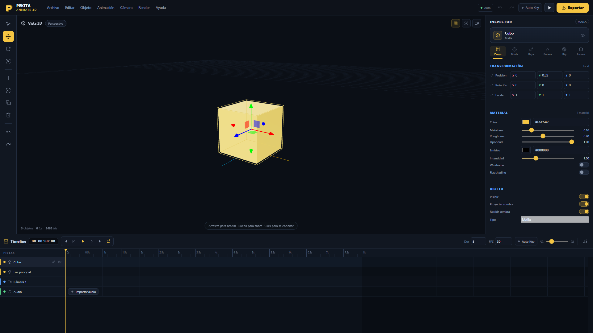
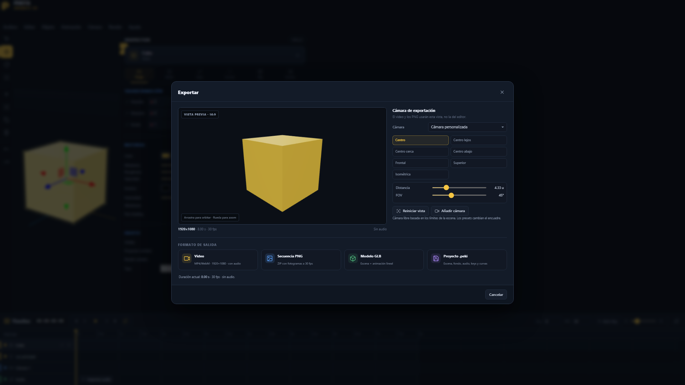

[README.md](https://github.com/user-attachments/files/33741561/README.md)
# PEKITA ANIMATE 3D

Animador 3D en el navegador con viewport estilo Blender, timeline estilo CapCut, keyframes con curvas Bézier, audio, fondos de imagen, rigging por controles y exportación de video, secuencia PNG, GLB o proyecto `.peki`.



## Lo que incluye

- **Viewport 3D**: órbita, zoom, paneo, gizmo XYZ de mover/rotar/escalar, selección con clic, rejilla, ejes, cámara activa y enfoque con `F`.
- **Cámara sin retardo**: órbita directa con zoom hacia el cursor, sin amortiguación; los controles responden al instante.
- **Inspector**: transformaciones, materiales, luces, cámaras, visibilidad, sombras, modificadores, jerarquía y una pestaña **Rig**.
- **Timeline profesional**: pistas por objeto, clips arrastrables, clips compuestos `RIG`, audio con forma de onda, claves visibles, regla en segundos, zoom, reproducción, bucle y cabezal arrastrable.
- **Animación**: claves por canal (posición, rotación y escala), Auto Key, editor de curvas cúbicas de Bézier, presets de easing y borrado/movimiento de claves.
- **Rigging rápido**: crea un vacío como control y emparenta objetos conservando su posición en el mundo. Al animar el control se mueve todo su grupo.
- **Clips compuestos**: el clip del padre agrupa las claves de todos sus hijos; al arrastrarlo se desplaza el rig completo con un solo gesto.
- **Fondos**: galería de fondos listos (verde croma, cielo con nubes, atardecer, estudio, degradados y cuadrícula) y opción de importar JPG, PNG, WebP, GIF o BMP. El fondo se adapta a la cámara, al viewport y a las imágenes y videos exportados.
- **Autoguardado**: una copia completa del proyecto se guarda en IndexedDB y se puede continuar desde la pantalla principal.
- **Pantalla principal**: al abrir la app eliges tamaño de render (Horizontal 16:9, Vertical 9:16, Cuadrado, Retrato, 720p o 4K, o medidas propias), FPS, duración y fondo inicial. Desde ahí también puedes continuar el proyecto guardado, abrir un `.peki` o importar un modelo.
- **Tamaño de render**: el tamaño elegido se usa igual para imágenes y videos, y puede cambiarse al final en **Exportar** sin tocar el proyecto.
- **Modelado rápido**: cubo, esfera, plano, cilindro, cono, toro, vacíos, luces direccional/puntual/foco/ambiental/hemisférica y cámaras.
- **Piezas ajustables**: cada primitiva conserva sus parámetros (tamaño, grosor, radio, lados, redondeo de bordes…) y se puede editar en vivo desde el inspector, sin perder el historial.
- **Materiales y texturas**: presets de material (plástico, oro, cristal, mate, emisivo…), importar una imagen como textura o crearla en un editor de texturas con pincel, bote de pintura, patrones y repetición.
- **Mapa de normales**: añade relieve (bultos, hendiduras, ladrillos en resalte) sin sumar polígonos. Importa un PNG de normales o genéralo desde la textura aplicada, con control de intensidad 0–3.
- **Copiar y pegar keyframes**: selecciona uno o varios nodos con el ratón —clic, `Shift`/`Ctrl` + clic o arrastrando un recuadro sobre la línea de tiempo— y usa `Ctrl` + `C` / `Ctrl` + `V` para duplicarlos en el cabezal. Se copian los tres canales con su easing y se pegan conservando la separación entre claves.
- **Modificadores**: alineación, array, espejo, suavizado, sombreado plano, wireframe y sombras.
- **Importación**: GLB, glTF (+ `.bin` y texturas seleccionadas juntas), OBJ + MTL, FBX, STL, PLY, DAE, 3MF, `.bbmodel` de Blockbench, proyectos **Prisma 3D** (`.prism` / `.prisma`) y `.proj` / `.projy` (contenedor ZIP, JSON, GLB u OBJ incrustado).
- **Exportación**: video con audio (MP4 si el navegador lo soporta; WebM como respaldo), imagen PNG del fotograma actual, secuencia PNG en ZIP, GLB con animación y proyecto `.peki` (escena, fondo, texturas, claves y audio). Todo respeta el tamaño de render elegido.
- **Cámara de exportación**: al pulsar **Exportar** se abre una vista previa con el tamaño final, botón de reproducir/pausar para revisar la animación y cámaras libres, cámaras de la escena y presets (Centro, Centro lejos, Centro cerca, Centro abajo, Frontal, Superior e Isométrica).
- **Interfaz oscura sencilla** pensada para 1920×1080, con acento amarillo y menos brillos.
- **Versión móvil estilo app**: en teléfonos la interfaz se convierte en un editor táctil con barra inferior de herramientas, panel de propiedades deslizante y línea de tiempo plegable. Un dedo orbita, dos dedos desplazan y hacen zoom, y un toque selecciona.

## Requisitos

- Node.js 18 o superior.
- Chrome o Edge actualizado para la mejor compatibilidad de video y WebGL.

## Inicio rápido

En Windows puedes hacer doble clic en `INICIAR.bat`. También puedes usar la terminal:

```bash
npm install
npm run dev
```

Abre la dirección que muestra Vite (por defecto `http://localhost:5173`).

Para probar la versión de producción:

```bash
npm run build
npm run preview
```

## Controles

| Acción | Atajo |
| --- | --- |
| Seleccionar / Mover / Rotar / Escalar | `Q` / `W` / `E` / `R` |
| Reproducir o pausar | `Espacio` |
| Añadir clave en el tiempo actual | `K` |
| Enfocar objeto seleccionado | `F` |
| Enfocar toda la escena | `Inicio` |
| Fotograma anterior / siguiente | `←` / `→` |
| Saltar un segundo | `Shift` + `←` / `→` |
| Borrar clave u objeto | `Supr` |
| Copiar / pegar keyframes | `Ctrl` + `C` / `Ctrl` + `V` |
| Seleccionar todos los keyframes | `Ctrl` + `A` |
| Duplicar | `Ctrl` + `D` |
| Guardar proyecto `.peki` | `Ctrl` + `S` |
| Abrir proyecto | `Ctrl` + `O` |
| Importar modelo | `Ctrl` + `I` |
| Exportar | `Ctrl` + `E` |
| Deshacer / Rehacer | `Ctrl` + `Z` / `Ctrl` + `Y` |

En el viewport: arrastra con el botón izquierdo para orbitar, usa la rueda para hacer zoom hacia el cursor y el botón derecho para desplazar. Haz clic en un objeto para seleccionarlo y usa el gizmo para transformarlo.

En la línea de tiempo: un clic en un nodo selecciona ese keyframe, `Shift` o `Ctrl` + clic añade o quita nodos de la selección y arrastrar sobre una pista dibuja un recuadro que selecciona todos los nodos que toca. Si arrastras uno de los nodos ya seleccionados, se mueven todos juntos; con varios nodos seleccionados el contador de la cabecera muestra cuántos hay.

## Versión móvil (teléfonos)

La misma app detecta si estás en un teléfono y cambia a una interfaz táctil de pantalla completa, inspirada en las apps de animación 3D para Android:

- **Barra inferior** con menú, herramientas (seleccionar, mover, rotar, escalar), importar, añadir objeto, clave, deshacer/rehacer, plegar la línea de tiempo, propiedades, reproducir y exportar.
- **Propiedades** como hoja inferior deslizante: pulsa el botón de la barra para abrirla y toca fuera para cerrarla.
- **Línea de tiempo** inferior plegable para dejar más espacio a la vista 3D.
- **Gestos**: un dedo orbita, dos dedos desplazan y hacen zoom, un toque selecciona y un doble toque enfoca.
- **Menú completo**: como la barra de menús no cabe, el botón **Menú** de la barra inferior abre todas las opciones (archivo, edición, objeto, animación, cámara, render y ayuda).
- **Rendimiento**: la densidad de píxeles se limita automáticamente para mantener la fluidez y no calentar el teléfono.

### Cómo abrir cada interfaz

| Quiero… | Dirección |
| --- | --- |
| Vista de escritorio | `https://tu-app.vercel.app/` |
| Vista móvil | `https://tu-app.vercel.app/?mobile=1` |
| Forzar escritorio en un teléfono | `https://tu-app.vercel.app/?desktop=1` |

También puedes cambiar de una a otra desde **Ayuda → Vista móvil / Vista de escritorio**; la elección se recuerda en el navegador.

Trucos para el teléfono:

1. Añade la página a la pantalla de inicio para abrirla a pantalla completa, sin barra del navegador.
2. Para precisar más, separa dos dedos para acercar la vista antes de mover el gizmo.
3. Para animar rápido: coloca el cabezal, pulsa **clave**, mueve el objeto y repite; o activa **Auto Key** en la barra superior.

## Autoguardado

- Mientras trabajas, la barra superior muestra el estado **Auto**: `Guardando`, `Guardado`, `Restaurado` o `Error`.
- El proyecto se guarda automáticamente en segundo plano después de los cambios y cada 15 segundos si hay modificaciones pendientes.
- También se guarda al ocultar la pestaña o cerrar la página.
- Al recargar la app se restaura la última copia automática, incluyendo objetos, jerarquía, fondo, audio, claves y curvas.
- La copia se guarda en IndexedDB, no en `localStorage`, porque puede incluir el modelo y la imagen de fondo completos.

## Flujo de trabajo recomendado

1. Importa el modelo (o crea primitivas) y selecciónalo.
2. Opcional: en **Rig**, crea un control y emparenta las partes que quieras mover juntas.
3. Coloca el cabezal en el fotograma deseado y pulsa `K`, o activa **Auto Key**.
4. Ajusta posición/rotación/escala con el gizmo o desde el inspector.
5. Abre la pestaña **Curvas** para afinar la interpolación entre claves.
6. Arrastra el clip o las claves en la timeline para reorganizar la animación.
7. Añade audio desde la pista **Audio** y ajusta inicio/volumen en **Escena**.
8. Añade una imagen de fondo desde **Escena → Fondo de la animación**.
9. Pulsa **Exportar**, elige la cámara en la vista previa y selecciona el formato.

## Rigging y clips compuestos

- Selecciona un objeto y pulsa **Rig → Crear control**. Se crea un vacío en la posición del objeto y el objeto se emparenta conservando su posición visual.
- Para emparentar otra pieza, selecciónala y elige el control en **Rig → Emparentar a un control**.
- Para separar una pieza, usa **Rig → Soltar del padre**.
- La pista del control muestra un clip con la etiqueta `RIG`. Ese clip abarca las claves del control y de todos sus descendientes.
- Al arrastrar el clip `RIG`, se desplazan todas las claves del grupo respetando el inicio y el final del proyecto.
- El control puede animarse con Auto Key o con claves manuales; el resto del rig lo sigue por jerarquía.

## Importar modelos

- **GLB**: un solo archivo, recomendado.
- **glTF**: selecciona el `.gltf` junto con su `.bin` y las texturas en la misma importación. El cargador resuelve las referencias por nombre de archivo.
- **OBJ**: si tiene `.mtl` y texturas, selecciona todos los archivos juntos.
- **FBX**: se importa la geometría y las texturas incrustadas; las animaciones del FBX no se convierten al sistema de claves de PEKITA.
- **Blockbench**: `.bbmodel` con cubos y texturas. Los tipos de malla avanzados se omiten con un aviso.
- **Prisma 3D (`.prism` / `.prisma`)**: el importador abre el archivo y prueba, en este orden:
  1. **ZIP**: busca dentro un GLB, glTF, OBJ, FBX, STL, PLY, DAE, 3MF, BBModel o un JSON de escena, y lo importa con sus texturas.
  2. **JSON**: interpreta BBModel, glTF o una escena genérica con arrays de vértices y caras.
  3. **GLB binario**: si el archivo entero es un GLB.
  4. **GLB incrustado**: busca la firma `glTF` dentro del binario y extrae el modelo.
  5. **OBJ incrustado**: busca texto `v …` / `f …` dentro del binario y reconstruye la malla.
- **`.proj` / `.projy`**: usan exactamente el mismo detector de contenedor que los `.prism`, así que aceptan cualquiera de los cinco casos anteriores.

> El formato `.prism` de Prisma 3D es propietario y no está documentado. El importador cubre los casos más habituales (contenedor ZIP o JSON con malla, GLB/OBJ incrustado) y, si no reconoce el archivo, muestra un aviso con los primeros bytes para poder añadir soporte con una muestra.

Si aun así no se reconoce, lo más fiable es exportar desde la app original a **GLB** o **OBJ**.

Las animaciones incluidas dentro de un GLB/FBX se importan en pose estática; PEKITA usa su propio sistema de claves para animar los objetos.

## Fondos

- Formatos: JPG, PNG, WebP, GIF, BMP.
- Se pueden cargar desde **Escena → Fondo de la animación**, desde **Archivo → Imagen de fondo…** o arrastrando una imagen a la ventana.
- El fondo usa un plano delante de la cámara: se recorta como `cover` para llenar el encuadre sin deformarse.
- Se incluye en el video, en la secuencia PNG y en el proyecto `.peki`.
- No forma parte del GLB exportado.

## Exportación

### Cámara de exportación



Al abrir **Exportar** aparece una vista previa de la cámara real que se usará en el video/PNG:

- **Cámara personalizada**: orbita arrastrando, zoom con la rueda y ajusta distancia/FOV con los controles.
- **Cámaras de la escena**: usa la posición, orientación y FOV de cualquier cámara añadida al proyecto.
- **Presets**: Centro, Centro lejos, Centro cerca, Centro abajo, Frontal, Superior e Isométrica.
- **Añadir cámara**: crea una cámara en la escena a partir del encuadre actual.
- La vista del editor no se usa para exportar. GLB y proyecto `.peki` no dependen de esta cámara.

### Video

La grabación es en tiempo real a 1920×1080 con la cámara elegida en el diálogo de exportación. En Chrome/Edge se intenta MP4 primero; si el navegador no lo soporta se genera WebM. El audio se incluye si hay una pista cargada. No cierres ni minimices la pestaña durante la grabación.

### Secuencia PNG

Genera un ZIP con `frame_0000.png`, `frame_0001.png`, etc., a 1920×1080 y a los FPS del proyecto, usando la cámara elegida. Es la opción más fiable para editar después en otro programa. Las secuencias muy largas consumen bastante memoria.

### GLB

Exporta la escena, materiales y luces, además de la animación. Las curvas Bézier se muestrean por fotograma para que el resultado en otros programas sea idéntico al del editor. El fondo de imagen no se incluye en el GLB.

### Proyecto `.peki`

Es un ZIP con `project.json`, `scene.glb`, el fondo (`background/…`) y el audio original (`audio/…`). Conserva claves, curvas, jerarquía, materiales, fondo, audio y ajustes del proyecto. Ábrelo con `Ctrl+O` o arrastrándolo a la ventana.

## Publicación

El proyecto está preparado para desplegarse como sitio estático (la configuración usa rutas relativas y `vercel.json` ya define Vite + `dist`):

```bash
npm install
npm run build
```

### 1. Subir a GitHub

Si usas **GitHub Desktop** (recomendado si no tienes `git` en el PATH):

1. Abre GitHub Desktop → **File → Add local repository**.
2. Elige `C:\Users\pekit\OneDrive\Desktop\pekita-animate-3d`.
3. Crea un repositorio nuevo y publica la rama `main`.

Si usas la terminal, Git ya está instalado en `C:\Program Files\Git\cmd\git.exe` aunque no esté en el PATH:

```powershell
$git = "C:\Program Files\Git\cmd\git.exe"
& $git config --global user.name "TU_USUARIO"
& $git config --global user.email "TU_CORREO"
& $git init -b main
& $git add .
& $git commit -m "PEKITA ANIMATE 3D: animador 3D en el navegador"
& $git remote add origin https://github.com/TU_USUARIO/pekita-animate-3d.git
& $git push -u origin main
```

Crea antes el repositorio vacío en GitHub (sin README, sin `.gitignore`) para evitar conflictos.

> ⚠️ **OneDrive**: el proyecto está dentro de una carpeta sincronizada. OneDrive puede bloquear o corromper `.git` mientras corre. Pausa la sincronización durante el `commit`/`push`, o mejor mueve el proyecto a una carpeta local como `C:\dev\pekita-animate-3d` antes de subirlo.

### 2. Desplegar en Vercel

1. Entra en [vercel.com](https://vercel.com) y conecta tu cuenta de GitHub.
2. **Add New → Project** e importa el repositorio `pekita-animate-3d`.
3. Vercel detecta la configuración de `vercel.json`:
   - Framework: **Vite**
   - Build Command: `npm run build`
   - Output Directory: `dist`
4. Pulsa **Deploy**. En 1–2 minutos tendrás una URL `*.vercel.app`.
5. Cada `git push` a `main` genera un despliegue nuevo automáticamente.

No hace falta configurar variables de entorno.

### Otros hostings

- **Netlify**: importa el repositorio con build `npm run build` y directorio `dist`.
- **GitHub Pages**: publica el contenido de `dist` en la rama `gh-pages`.
- **Cualquier hosting estático**: copia `dist` a la raíz pública.

No se necesita servidor Node en producción: todo el renderizado, la animación, el autoguardado y la exportación ocurren en el navegador.

### Checklist antes de publicar

1. Ejecuta `npm install` para sincronizar el lockfile.
2. Ejecuta `npm run build` y comprueba que termina sin errores.
3. Abre `dist/index.html` con `npm run preview` y prueba: importar un GLB, mover la cámara, añadir fondo, crear un rig, exportar un PNG corto y recargar para verificar el autoguardado.
4. Abre `http://localhost:4173/?mobile=1` y revisa la vista de teléfono (también puedes reducir la ventana o usar el modo dispositivo del navegador).
5. Sube el repositorio a GitHub y despliega en Vercel.
6. Si usas un subdirectorio, las rutas relativas de `vite.config.js` ya permiten que funcione sin cambios.

## Estructura

```text
src/
  app.js                 Estado central, selección, claves, historial, autoguardado y archivos
  main.js                Arranque, detección de móvil, drag & drop y manejo de errores
  style.css              Interfaz de escritorio
  mobile.css             Interfaz móvil (bajo body.is-mobile)
  icons.js               Iconos SVG y logo 3D de PEKITA
  core/
    viewport.js          Three.js, cámara, gizmo, selección, fondo y captura
    animation.js         Pistas, claves, muestreo y curvas
    easing.js            Cubic-bezier y presets
    audio.js             Decodificación, waveform y reproducción
    importer.js          Cargadores de modelos, bbmodel, Prisma y PROJ
    exporter.js          Video, PNG, GLB, proyecto .peki y cámara de exportación
    autosave.js          Copia automática en IndexedDB
  ui/
    topbar.js            Menús, historial, auto-key, autoguardado y exportación
    toolrail.js          Herramientas de transformación (escritorio)
    mobilebar.js         Barra inferior táctil y hoja de menú (móvil)
    inspector.js         Propiedades, modificadores, curvas, rig y jerarquía
    timeline.js          Timeline, clips, clips RIG, audio, claves y transporte
    ui.js                Toasts, modales y progreso
```

## Limitaciones conocidas

- Deshacer/rehacer cubre transformaciones, claves y ajustes; añadir o eliminar objetos reinicia el historial.
- El video se graba en tiempo real: un clip de 30 s tarda unos 30 s en exportarse.
- El MP4 depende del soporte de `MediaRecorder` del navegador; en algunos equipos solo estará disponible WebM.
- La importación de animaciones esqueléticas externas no está implementada; se importa la pose estática.
- Para modelos con muchas texturas externas, selecciona todos los archivos a la vez.
- El autoguardado ocupa espacio en IndexedDB; si el navegador borra los datos del sitio, la copia también desaparece.
- Un `.prism` / `.proj` propietario que no sea ZIP, JSON, GLB ni OBJ incrustado no se puede interpretar; en ese caso exporta desde la app original a GLB/OBJ y, si quieres soporte directo, comparte una muestra del archivo.
- La interfaz móvil reutiliza el mismo motor: la escena y el autoguardado son idénticos en teléfono y escritorio, pero el historial de autoguardado es por dominio.

---

Hecho para Pekita. Si algo no carga, abre la consola del navegador: los errores de importación y exportación se muestran también como avisos en la interfaz.
